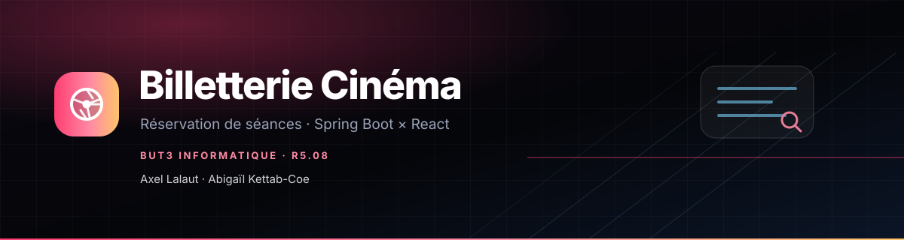
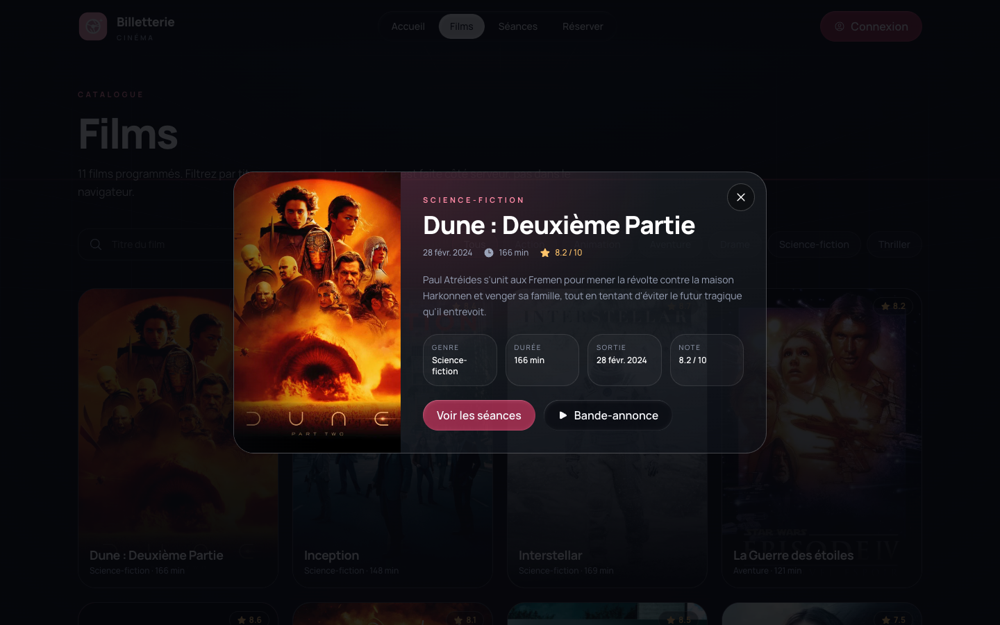
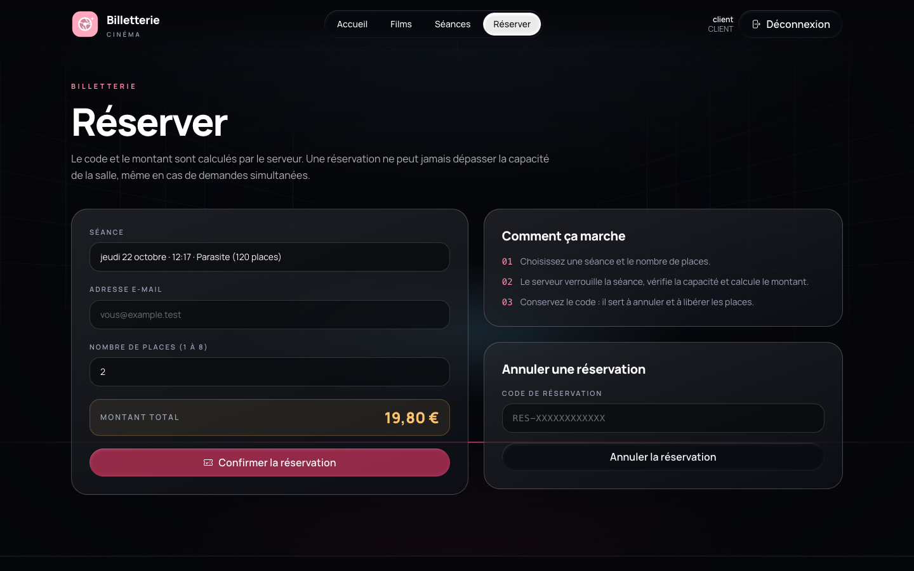
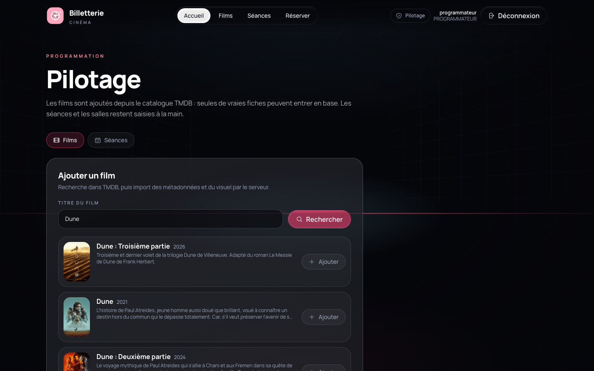
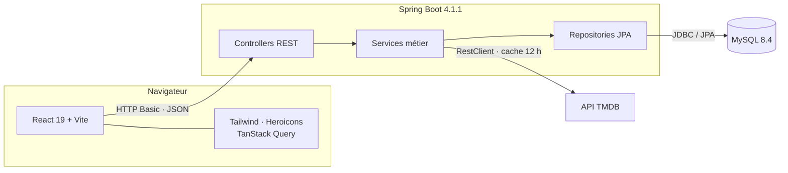
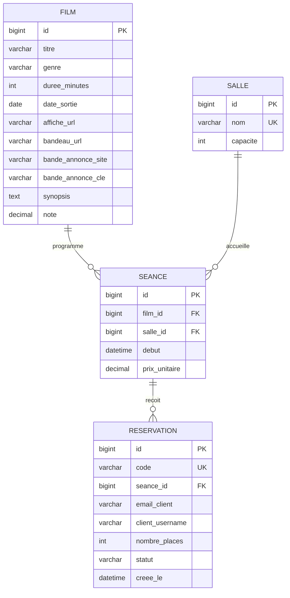
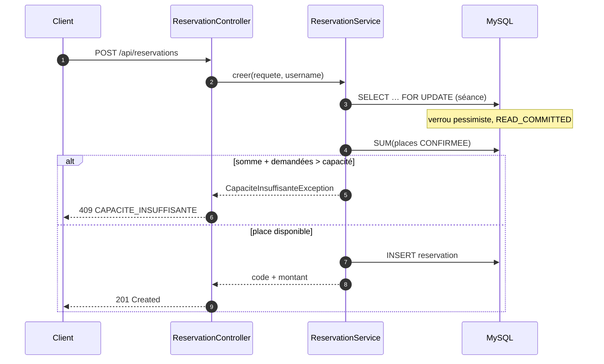
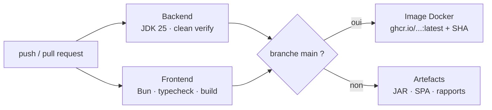

<p align="center">
  
</p>

<p align="center">
  <a href="https://github.com/Axxel-L/tp-billeterie-cinema/actions/workflows/ci.yml">
    
  </a>
  
  
  
  
  
  
  
  
  
  
</p>

<p align="center">
  
  
  
</p>

<p align="center">
  <strong>Axel Lalaut</strong> · <strong>Abigaïl Kettab-Coe</strong><br>
  BUT3 Informatique, SAÉ R5.08 · 2026
</p>

---

## Sommaire

- [Aperçu](#aperçu)
- [Fonctionnalités](#fonctionnalités)
- [Stack technique](#stack-technique)
- [Démarrage rapide](#démarrage-rapide)
- [Configuration `.env`](#configuration-env)
- [Architecture](#architecture)
- [Modèle de données](#modèle-de-données)
- [API](#api)
- [Concurrence : la règle qui ne casse pas](#concurrence--la-règle-qui-ne-casse-pas)
- [Frontend et design](#frontend-et-design)
- [Sécurité](#sécurité)
- [Tests](#tests)
- [CI/CD et image Docker](#cicd-et-image-docker)
- [Structure du projet](#structure-du-projet)
- [Équipe](#équipe)
- [Compte rendu](#compte-rendu)

## Aperçu

Une billetterie de cinéma complète : catalogue de films, séances, réservation et annulation,
avec une interface publique façon plateforme de streaming et un espace de pilotage pour la
programmation. Le point technique central : **la capacité d'une salle ne peut jamais être
dépassée**, même quand plusieurs clients réservent la même séance au même instant.

| Accueil | Catalogue |
| --- | --- |
|  |  |

| Fiche film + trailer | Séances et réservations du client |
| --- | --- |
|  |  |

| Réservation | Pilotage / import TMDB |
| --- | --- |
|  |  |

## Fonctionnalités

- 🎬 **Catalogue réel** : six films de démonstration avec affiches, bannières, synopsis, notes
  et bandes-annonces TMDB, stockés en base.
- 🔎 **Recherche et import TMDB** : l'administrateur ne peut ajouter qu'un film existant.
  Les métadonnées sont rechargées côté serveur, jamais fournies par le navigateur.
- 🗓️ **Séances filtrables** par période, avec places restantes calculées en temps réel.
- 🎟️ **Réservation** : code unique, montant calculé côté serveur, confirmation immédiate.
- 👤 **Mes réservations** : un client connecté voit ses séances à venir, ses codes et peut
  annuler. Il ne peut pas toucher aux réservations d'un autre compte.
- 🛡️ **Trois rôles** : `CLIENT`, `PROGRAMMATEUR`, `ADMIN` (ADMIN hérite des deux autres).
- 🧊 **Interface** : hero streaming, vidéo de fond, liquid glass sur la navbar et les boutons,
  GridScan CSS, écrans de chargement et images en `srcset`.

## Stack technique

| Couche | Choix | Pourquoi |
| --- | --- | --- |
| Langage | **Java 25** | LTS, records, `List.getFirst()`, virtual threads |
| Framework | **Spring Boot 4.1.1** | Version imposée, modules `webmvc` / test dédiés |
| Persistance | **MySQL 8.4**, Spring Data JPA, **Flyway** | Transactions, verrous, `ddl-auto=validate` |
| Sécurité | Spring Security, HTTP Basic, BCrypt | Pas de JWT, pas de cookie de session |
| Contrat | springdoc-openapi 3.1.1 | Swagger UI + OpenAPI public |
| Frontend | **React 19**, Vite 7, TypeScript | SPA rapide, composants modernes |
| Style | **Tailwind CSS 4**, Heroicons | Design system compact, icônes cohérentes |
| Données SPA | TanStack Query | Cache, invalidations, états de chargement |
| Outillage | **Bun**, Maven Wrapper | Install/dev/build frontend. Build backend reproductible |
| Tests | JUnit 5, Mockito, Testcontainers MySQL | Unitaires, MVC, JPA, intégration, concurrence |
| CI/CD | GitHub Actions + Docker + GHCR | Tests, build, image publiée sur `main` |

## Démarrage rapide

```bash
git clone https://github.com/Axxel-L/tp-billeterie-cinema.git
cd tp-billeterie-cinema

docker compose up -d          # MySQL 8.4 sur :3306
cp .env.example .env          # facultatif : TMDB_API_KEY

./mvnw clean verify           # 29 tests + JAR
java -jar target/billetterie-cinema-1.0.0.jar
```

L'application écoute sur **http://localhost:8080** : SPA + API + Swagger UI.

Comptes de démonstration (mots de passe hachés BCrypt dans la configuration) :

| Identifiant | Mot de passe | Rôle |
| --- | --- | --- |
| `client` | `client123` | CLIENT |
| `programmateur` | `programmateur123` | PROGRAMMATEUR |
| `admin` | `admin123` | ADMIN |

Frontend en développement :

```bash
cd frontend
bun install
bun run dev      # http://localhost:5173, proxy /api → :8080
bun run build    # génère src/main/resources/static
```

> Le build Maven ne dépend **jamais** de Node/Bun. `clean verify` reste la référence du sujet.

### Scripts racine

Le `package.json` de la racine ne contient **aucune dépendance** : il orchestre les commandes.
`bun run …` et `npm run …` fonctionnent tous les deux si Bun est installé.

| Commande | Effet |
| --- | --- |
| `bun run init` | copie `.env`, démarre MySQL, installe le frontend |
| `bun run dev` | lance Spring Boot sur `:8080` et Vite sur `:5173` |
| `bun run build` | compile la SPA puis le JAR exécutable |
| `bun run verify` | typecheck frontend + `./mvnw clean verify` |
| `bun run start` | exécute le JAR déjà construit |

```bash
bun run init
bun run dev        # ou bun run verify puis bun run build
```

### Docker

```bash
docker build -t billetterie-cinema .
docker run --rm -p 8080:8080 \
  -e DB_URL='jdbc:mysql://host.docker.internal:3306/billetterie' \
  -e TMDB_API_KEY="$TMDB_API_KEY" \
  billetterie-cinema
```

### Sans Docker

Les tests Testcontainers sont ignorés (`disabledWithoutDocker = true`) : les autres tests
restent verts et `clean verify` passe. Avec **colima** sur macOS :

```bash
export DOCKER_HOST=unix://$HOME/.colima/default/docker.sock
export TESTCONTAINERS_DOCKER_SOCKET_OVERRIDE=/var/run/docker.sock
```

## Configuration `.env`

`application.yml` importe `./.env` via `spring.config.import` : aucun script de lancement,
aucune dépendance supplémentaire.

```bash
cp .env.example .env
# TMDB_API_KEY=...
./mvnw spring-boot:run
```

- `.env` est **ignoré par Git** et exclu du contexte Docker. Seul `.env.example` est versionné.
- Une variable exportée dans le shell reste prioritaire.
- La clé est lue au démarrage : redémarrer après modification.
- Sans clé, les six films de démo restent complets (médias stockés en base). Seule la
  **recherche de nouveaux films** renvoie `503 TMDB_NON_CONFIGURE`.

## Déploiement sur une autre machine

Oui, un collègue peut cloner et lancer le projet, avec **JDK 25**, **Docker** (ou colima) et
**Bun 1.4+**.

```bash
git clone https://github.com/Axxel-L/tp-billeterie-cinema.git
cd tp-billeterie-cinema

cp .env.example .env     # facultatif : TMDB_API_KEY
bun run init             # MySQL + dépendances frontend
bun run verify           # 29 tests, ou tests MySQL ignorés sans Docker
bun run build            # SPA + JAR
bun run start            # http://localhost:8080
```

Points à connaître :

- `src/main/resources/static/` est **ignoré par Git** : sans `bun run build`, le JAR démarre
  mais ne sert pas la SPA. C'est volontaire : le build Maven ne dépend pas de Bun.
- Sans Docker, `clean verify` passe mais les tests Testcontainers sont ignorés. L'application
  a tout de même besoin d'un MySQL accessible (`DB_URL`).
- Sans `TMDB_API_KEY`, les six films de démo et leurs médias fonctionnent. La recherche de
  nouveaux films répond `503 TMDB_NON_CONFIGURE`.
- Les ports `3306` et `8080` doivent être libres. Modifiable dans `docker-compose.yml` et
  `application.yml`.
- Sous Windows, les scripts utilisent automatiquement `mvnw.cmd`.
- Avec colima, `bun run verify` détecte `~/.colima/default/docker.sock` et exporte les
  variables Testcontainers.
- La CI GitHub Actions rejoue exactement ces étapes sur un runner propre.

## Architecture




Principes :

- **Contrôleurs fins** : validation Jakarta, DTO `record`, aucun accès direct aux entités.
- **Règles métier dans `service`** : montant, capacité, code, propriétaire, annulation.
- **Erreurs centralisées** dans `GlobalExceptionHandler` → `ApiError` stable, sans SQL ni stack trace.
- **Aucune entité JPA exposée** : le contrat public est entièrement typé.

## Modèle de données



Migrations Flyway :

| Version | Contenu |
| --- | --- |
| `V1__schema_initial.sql` | Tables, clés étrangères, index et contraintes `CHECK` |
| `V2__donnees_demo.sql` | Première démo : films, salles, séances |
| `V3__medias_et_reservations_client.sql` | Médias, synopsis, note, `client_username`, six films réels |
| `V4__bande_annonce_site.sql` | Fournisseur de bande-annonce (`YouTube`, `Vimeo`, `Dailymotion`) |
| `V5__trailers_youtube.sql` | Clés officielles des six trailers de démonstration |

## API

Authentification **HTTP Basic**. Lectures publiques sans identifiants.

| Méthode | Chemin | Accès | Réponses |
| --- | --- | --- | --- |
| `GET` | `/api/films?titre=&genre=` | public | `200`, filtres optionnels |
| `GET` | `/api/films/{id}` | public | `200`, `404` |
| `GET` | `/api/films/{id}/media` | public | `200` (affiche, bannière, trailer, synopsis, note) |
| `GET` | `/api/seances?du=&au=` | public | `200`, dates incluses, défaut J → J+7 |
| `GET` | `/api/seances/{id}` | public | `200`, `404`, `placesRestantes` |
| `GET` | `/api/salles` | public | `200` |
| `GET` | `/api/auth/me` | authentifié | `200`, identifiant + rôles |
| `POST` | `/api/programmation/films` | PROGRAMMATEUR, ADMIN | `201` |
| `GET` | `/api/programmation/films/recherche?titre=` | PROGRAMMATEUR, ADMIN | `200`, `503` sans clé |
| `POST` | `/api/programmation/films/depuis-tmdb` | PROGRAMMATEUR, ADMIN | `201`, `409`, `503` |
| `POST` | `/api/programmation/seances` | PROGRAMMATEUR, ADMIN | `201`, `400` |
| `POST` | `/api/admin/salles` | ADMIN | `201`, `400`, `409` |
| `POST` | `/api/reservations` | CLIENT, ADMIN | `201`, `400`, `404`, `409` |
| `GET` | `/api/reservations/mes-reservations` | CLIENT, ADMIN | `200`, réservations à venir |
| `DELETE` | `/api/reservations/{code}` | CLIENT propriétaire, ADMIN | `204`, `404` |
| `GET` | `/actuator/health` | public | `200` |

Swagger UI : [`/swagger-ui.html`](http://localhost:8080/swagger-ui.html) ·
OpenAPI : [`/v3/api-docs`](http://localhost:8080/v3/api-docs).

```bash
curl -u client:client123 -X POST http://localhost:8080/api/reservations \
  -H 'Content-Type: application/json' \
  -d '{"seanceId":1,"emailClient":"lea@example.test","nombrePlaces":3}'
```

```json
{
  "code": "RES-9V55H0ABS9H",
  "statut": "CONFIRMEE",
  "nombrePlaces": 3,
  "montantTotal": 29.70,
  "seanceId": 1,
  "emailClient": "lea@example.test",
  "creeeLe": "2026-10-21T14:17:34.257798"
}
```

Erreurs : corps `ApiError` (`timestamp`, `status`, `code`, `message`, `path`), sans détail
interne.

| Situation | Statut | Code |
| --- | --- | --- |
| Validation / JSON illisible | `400` | `VALIDATION_ECHOUEE` |
| Film ou salle inconnu à la création d'une séance | `400` | `FILM_INTROUVABLE`, `SALLE_INTROUVABLE` |
| Ressource absente | `404` | `SEANCE_INTROUVABLE`, `RESERVATION_INTROUVABLE`, … |
| Capacité insuffisante | `409` | `CAPACITE_INSUFFISANTE` |
| Nom de salle déjà pris | `409` | `SALLE_EXISTANTE` |
| Film déjà programmé | `409` | `FILM_EXISTANT` |
| TMDB sans clé | `503` | `TMDB_NON_CONFIGURE` |
| Authentification / rôle | `401` / `403` | réponses Spring Security |

## Concurrence : la règle qui ne casse pas

**Invariant** : `somme(places CONFIRMEE) ≤ salle.capacite`, pour toutes les séances, en
permanence.



- `SeanceRepository.findByIdForUpdate` : `@Lock(PESSIMISTIC_WRITE)` → `SELECT … FOR UPDATE`.
- `@Transactional(isolation = READ_COMMITTED)` : en `REPEATABLE READ` (défaut MySQL), la
  lecture de la somme pourrait réutiliser un snapshot antérieur au commit concurrent.
- L'annulation **libère** la capacité et ne prend pas le verrou : elle ne peut pas violer
  l'invariant. Elle est idempotente (`204` si déjà annulée).
- Le verrou est en base : il protège aussi plusieurs instances applicatives.
- Alternative écartée : `@Version` + retry, non déterministe et plus fragile à tester. Compteur `places_restantes` dénormalisé, hors du modèle imposé.

Test de concurrence réel : capacité 20, 15 places déjà prises, deux requêtes simultanées de
4 places → **exactement une réussit**, total final **19 ≤ 20**.

## Frontend et design

- **Hero streaming** : backdrop du film en vedette, titre, année · durée · genre · note,
  synopsis, boutons *Réserver*, *Bande-annonce*, *Plus d'infos* et rappel de la prochaine séance.
- **Vidéo de fond** : trailer muet en autoplay sur desktop, désactivé sur mobile, en
  `prefers-reduced-motion` et en économie de données. Le bouton ouvre la version sonore.
- **TMDB** : affiches, bannières, synopsis, notes et trailers. La clé reste côté serveur,
  cache mémoire 12 h, échec 10 min. Les six démos embarquent leurs médias : **aucune clé
  nécessaire pour les voir**.
- **Liquid glass** : moteur officiel auto-hébergé, limité à la navbar et aux boutons. Les
  panneaux utilisent un verre CSS sans filtre SVG pour préserver les performances.
- **GridScan CSS** : grille en perspective + faisceau animé, une seule animation `transform`,
  pas de WebGL ni de shader plein écran.
- **Écrans de chargement** : `PageGate` attend les données et les images visibles (timeout 3 s),
  loader inline avant l'hydratation React, barre de progression sur les requêtes.
- **Images** : `srcset` TMDB (w342 / w500 / w780), `loading="lazy"`, `decoding="async"`,
  `fetchPriority` sur le hero, fondu à l'arrivée. Aucune requête média par carte : les champs
  arrivent avec `/api/films`.
- **Zéro ombre portée**, bordures et rayons généreux partout. Theme sombre, Manrope
  auto-hébergée, icônes Heroicons.

## Sécurité

- HTTP Basic, sessions `STATELESS`, **BCrypt**, hiérarchie `ADMIN > PROGRAMMATEUR` et
  `ADMIN > CLIENT`.
- **CSRF désactivé** : aucun cookie de session, aucune requête ambiante à protéger. L'authentification est portée par l'en-tête `Authorization`.
- Un `CLIENT` ne peut annuler que ses réservations (`client_username`). `ADMIN` peut tout
  annuler. Les codes sont générés avec `SecureRandom` et protégés par une contrainte unique.
- Injections SQL : uniquement Spring Data / JPQL paramétré.
- Aucun identifiant dans `localStorage` : l'en-tête Basic vit en mémoire et disparaît au
  rechargement. Pas de CDN de code, pas de script tiers non versionné.
- Actuator : seul `health` est exposé, sans détail.
- `TMDB_API_KEY` uniquement côté serveur (`.env`), jamais dans le bundle.

## Tests

```bash
./mvnw clean verify      # 29 tests
```

| Classe | Type | Couverture |
| --- | --- | --- |
| `ReservationServiceTest` | unitaire (Mockito) | montant, capacité, annulation, propriété, mes réservations |
| `MediaServiceTest` | unitaire (MockRestServiceServer) | mapping TMDB, recherche, détail, absence de clé |
| `ReservationControllerTest` | MVC (`@WebMvcTest`) | `201`, `400`, `401`, `403`, `201` admin |
| `ReservationRepositoryTest` | JPA + MySQL | somme des places confirmées, intervalle |
| `ReservationIntegrationTest` | intégration + MySQL | migrations, médias, réservation, mes réservations, `409`, `503` |
| `ReservationConcurrencyTest` | concurrence + MySQL | deux threads, aucune surréservation |

Les tests MySQL utilisent **Testcontainers** (`mysql:8.4`) et sont ignorés sans Docker.
Le test de concurrence n'est **pas** `@Transactional` : chaque thread ouvre sa transaction.

## CI/CD et image Docker



- **Backend** : JDK 25, `./mvnw clean verify`, rapports Surefire et JAR.
- **Frontend** : Bun, `bun install --frozen-lockfile`, `bun run typecheck`, `bun run build`.
- **Déploiement** sur `main` : image multi-stage (Bun → Maven → JRE 25) publiée sur GHCR,
  tags `latest` et SHA.
- Le `Dockerfile` compile la SPA avec Bun et le JAR avec Maven, **sans faire dépendre le
  build Maven de Node**.

## Structure du projet

```text
.
├── pom.xml                    Spring Boot 4.1.1 · Java 25
├── mvnw / .mvn/               Maven Wrapper
├── docker-compose.yml         MySQL 8.4
├── Dockerfile                 Bun + Maven + JRE 25
├── .github/workflows/ci.yml   backend · frontend · GHCR
├── docs/                      bannières, schémas, captures
├── frontend/                  React 19 · Vite · Tailwind · Bun
│   ├── public/liquidglass/    moteur liquid glass auto-hébergé
│   └── src/
│       ├── components/        Glass, FilmCard, FilmDialog, GridScan, PageGate…
│       ├── pages/             Accueil · Films · Séances · Réserver · Pilotage
│       ├── api/               client HTTP + types
│       └── lib/               formats, images, vidéo, préchargement
└── src/
    ├── main/java/fr/butinfo/r508/billetterie/
    │   ├── config/            sécurité, OpenAPI, TMDB
    │   ├── domain/            Film · Salle · Seance · Reservation
    │   ├── repository/        Spring Data JPA
    │   ├── service/           métier, concurrence, médias
    │   ├── web/               contrôleurs + DTO records
    │   └── error/             ApiError + exceptions
    ├── main/resources/
    │   ├── db/migration/      V1 → V5
    │   └── static/            SPA compilée (gitignored)
    └── test/java/             unitaires · MVC · JPA · intégration · concurrence
```

## Équipe

<table>
  <tr>
    <td align="center" width="50%">
      <br>
      <strong>Axel Lalaut</strong><br>
      <sub>Conception · développement · tests</sub>
    </td>
    <td align="center" width="50%">
      <br>
      <strong>Abigaïl Kettab-Coe</strong><br>
      <sub>Conception · développement · tests</sub>
    </td>
  </tr>
</table>

Projet réalisé en binôme dans le cadre de la SAÉ **R5.08, Développer pour le web**,
BUT3 Informatique.

## Compte rendu

Le détail de la conception, des choix techniques, de la recette A1 à A10 et du bilan est
disponible dans [`compte-rendu-kettab-lalaut.md`](compte-rendu-kettab-lalaut.md).

## Sources et remerciements

- [React Bits, GridScan](https://reactbits.dev/backgrounds/grid-scan) (inspiration,
  réimplémenté en CSS pour la performance)
- [Liquid Glass](https://liquidglass.dev/) pour le moteur navbar / boutons
- [Heroicons](https://heroicons.com/) pour les icônes
- [TMDB](https://www.themoviedb.org/) pour les métadonnées, affiches et trailers
- [Shields.io](https://shields.io/) pour les badges
