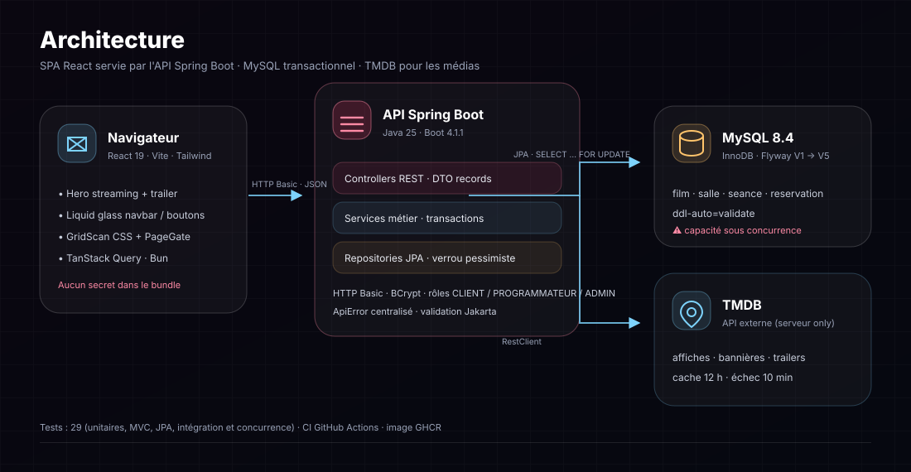
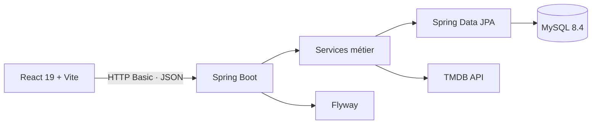
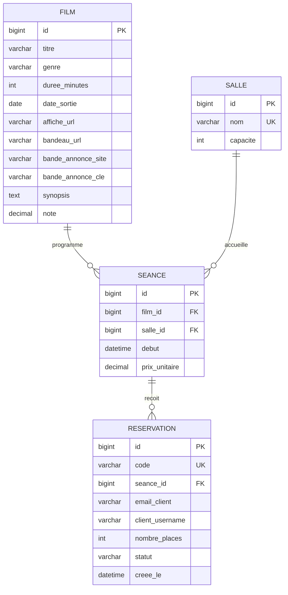
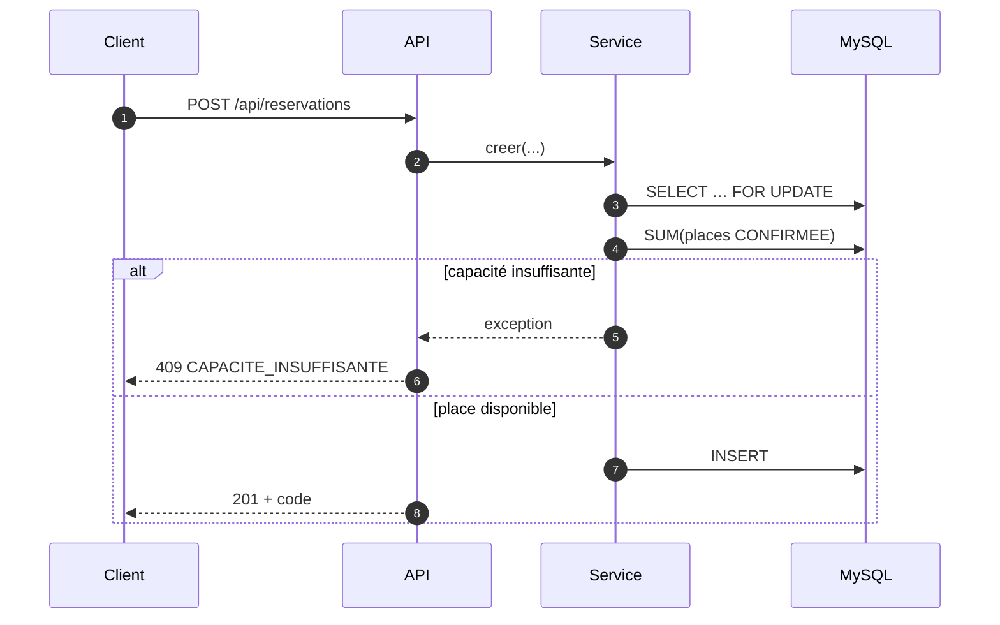
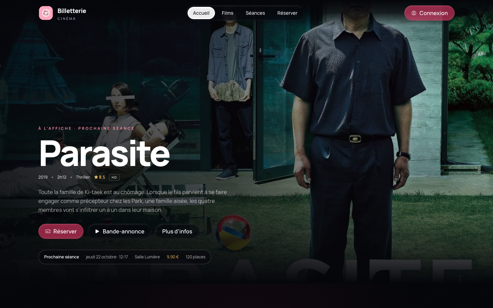
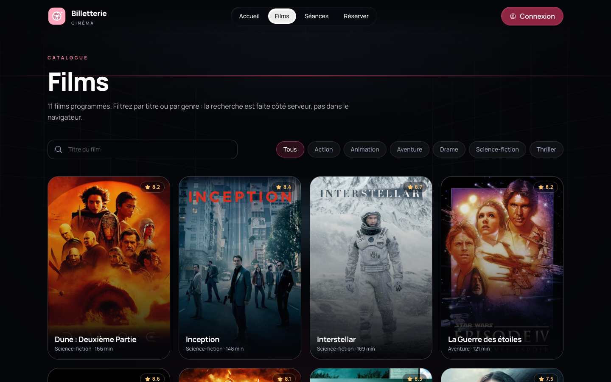
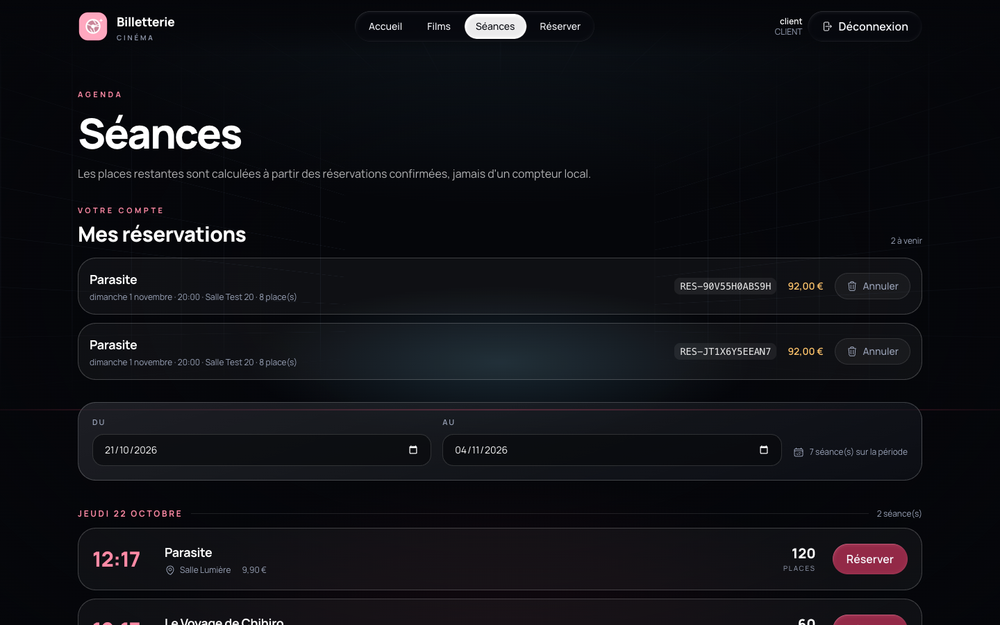

# Billetterie de cinéma, compte rendu

**Auteurs :** Axel Lalaut · Abigaïl Kettab-Coe 
**Formation :** BUT3 Informatique, SAÉ R5.08 
**Dépôt :** [Axxel-L/tp-billeterie-cinema](https://github.com/Axxel-L/tp-billeterie-cinema)

---

## 1. Présentation du projet

L'objectif est de réaliser une billetterie de cinéma : consulter les films et les séances,
réserver des places, annuler une réservation, et disposer d'un espace de programmation pour
créer les films, les salles et les séances.

Le sujet impose la stack (Java 25, Spring Boot 4.1.1, Maven, MySQL, Flyway, HTTP Basic,
Testcontainers) et un invariant fort : **la somme des places confirmées d'une séance ne doit
jamais dépasser la capacité de la salle**, y compris lorsque plusieurs clients réservent en
même temps. C'est le cœur technique du projet.

Nous avons ajouté une SPA React complète, une intégration TMDB (affiches, synopsis, notes,
trailers) et une interface de pilotage. Le rendu public adopte les codes d'une plateforme de
streaming : hero plein écran, vidéo de fond, fiches films, réservation en quelques clics.

### 1.1 Conformité au sujet

| Bloc du sujet | Points | Statut | Preuve |
| --- | --- | --- | --- |
| Environnement et Maven | 1,5 | ✅ | Parent 4.1.1, `release 25`, wrapper, scopes, plugin |
| Persistance et migrations | 3,5 | ✅ | MySQL 8.4, Flyway V1→V5, `validate`, pas de H2 |
| API et contrat | 4,5 | ✅ | Endpoints, DTO records, validation, `ApiError`, `Location` |
| Sécurité | 2,5 | ✅ | HTTP Basic, BCrypt, 3 rôles, 401/403, actuator limité |
| Capacité et concurrence | 3,5 | ✅ | `PESSIMISTIC_WRITE`, `READ_COMMITTED`, 409, test 5 places |
| Tests | 3,0 | ✅ | 29 tests, Testcontainers, limite Docker documentée |
| Exploitation et documentation | 1,5 | ✅ | Health, OpenAPI, JAR, README, choix justifiés |
| Bonus | 1,0 | ❌ | Non implémenté, priorité au socle |

Le seul point de vigilance est le **JDK local** : la CI utilise Java 25, et le projet compile
avec `release 25`. Un poste en Java 26 peut exécuter Maven, mais `./mvnw -version` affichera
26. Il faut installer un JDK 25 pour être strictement conforme à A1.

## 2. Choix techniques

| Besoin | Choix | Justification |
| --- | --- | --- |
| Langage / framework | Java 25 · Spring Boot 4.1.1 | Versions imposées. Boot 4 est la branche compatible Java 25 |
| Base | MySQL 8.4 + Flyway | Transactions et verrous robustes. Schéma versionné, `ddl-auto=validate` |
| Accès données | Spring Data JPA | Requêtes paramétrées, verrou pessimiste déclaratif |
| Sécurité | Spring Security · HTTP Basic · BCrypt | Imposé. Pas de JWT, pas de cookie de session |
| Contrat | springdoc-openapi 3.1.1 | Swagger UI et OpenAPI publics |
| Tests | JUnit 5 · Mockito · Testcontainers | Tests unitaires, MVC, JPA, intégration, concurrence |
| Frontend | React 19 · Vite 7 · TypeScript · Tailwind 4 | SPA rapide, typée, composants maison |
| Outillage front | **Bun** | Installation, dev, build et typecheck |
| CI/CD | GitHub Actions · Docker · GHCR | Tests sur chaque push, image publiée sur `main` |

Nous avons volontairement évité les dépendances non nécessaires (Lombok, MapStruct, Redis,
Kafka). Les DTO sont des `record` immuables, les entités ont des getters explicites.

## 3. Architecture





- **Contrôleurs fins** : validation Jakarta, DTO, codes HTTP, aucun accès direct au repository.
- **Services** : règles métier, transactions, verrouillage, calcul du montant, génération du code.
- **Repositories** : Spring Data JPA, requêtes JPQL paramétrées.
- **Erreurs** : `GlobalExceptionHandler` → `ApiError` stable, sans SQL ni stack trace.
- **Configuration** : `SecurityConfig`, `OpenApiConfig`, `MediaConfig`, `TmdbProperties`.

Le back-end et la SPA partagent la même origine en production : le JAR sert `static/`, ce qui
supprime CORS et simplifie la démonstration. En développement, Vite proxy `/api` vers `:8080`.

## 4. Modèle de données



Contraintes notables : `salle.nom` unique, `reservation.code` unique, `CHECK` sur la durée
(40 à 300 min), la capacité (20 à 500), le prix (> 0), les places (1 à 8) et le statut
(`CONFIRMEE` / `ANNULEE`). Index sur les dates de séance, `(seance_id, statut)` pour le calcul
des places et `(client_username, statut)` pour « mes réservations ».

Migrations :

| Version | Contenu |
| --- | --- |
| `V1__schema_initial.sql` | Tables, FK, index, `CHECK` |
| `V2__donnees_demo.sql` | Première démo (films, salles, séances) |
| `V3__medias_et_reservations_client.sql` | Médias, synopsis, note, propriétaire, six films réels |
| `V4__bande_annonce_site.sql` | Fournisseur du trailer |
| `V5__trailers_youtube.sql` | Clés officielles des six démos |

`spring.jpa.hibernate.ddl-auto=validate` vérifie le mapping à chaque démarrage : Hibernate ne
crée jamais le schéma.

## 5. API

Authentification **HTTP Basic**. Les lectures sont publiques. Les écritures sont protégées.

| Méthode | Chemin | Accès |
| --- | --- | --- |
| `GET` | `/api/films`, `/api/films/{id}`, `/api/films/{id}/media` | public |
| `GET` | `/api/seances?du=&au=`, `/api/seances/{id}` | public |
| `GET` | `/api/salles` | public |
| `GET` | `/api/auth/me` | authentifié |
| `POST` | `/api/programmation/films`, `/api/programmation/seances` | PROGRAMMATEUR, ADMIN |
| `GET` | `/api/programmation/films/recherche?titre=` | PROGRAMMATEUR, ADMIN |
| `POST` | `/api/programmation/films/depuis-tmdb` | PROGRAMMATEUR, ADMIN |
| `POST` | `/api/admin/salles` | ADMIN |
| `POST` | `/api/reservations` | CLIENT, ADMIN |
| `GET` | `/api/reservations/mes-reservations` | CLIENT, ADMIN |
| `DELETE` | `/api/reservations/{code}` | CLIENT propriétaire, ADMIN |
| `GET` | `/actuator/health` | public |
| `GET` | `/v3/api-docs`, `/swagger-ui.html` | public |

Réponses d'erreur : `ApiError` (`timestamp`, `status`, `code`, `message`, `path`).
Principaux codes : `VALIDATION_ECHOUEE` (400), `SEANCE_INTROUVABLE` (404),
`CAPACITE_INSUFFISANTE` (409), `SALLE_EXISTANTE` (409), `FILM_EXISTANT` (409),
`TMDB_NON_CONFIGURE` (503).

## 6. Concurrence

**Invariant** : `somme(places CONFIRMEE) ≤ salle.capacite`.

**Stratégie retenue : verrou pessimiste en base.**

```java
@Lock(LockModeType.PESSIMISTIC_WRITE)
@Query("select s from Seance s where s.id = :id")
Optional<Seance> findByIdForUpdate(Long id);
```

`ReservationService.creer` est annoté `@Transactional(isolation = READ_COMMITTED)` :

1. Charger la séance avec `SELECT … FOR UPDATE` (404 si absente).2. Calculer la somme des places `CONFIRMEE` pour cette séance.3. Si `somme + demandées > capacité`, lever `CapaciteInsuffisanteException` (409) **avant**
   toute écriture.4. Sinon générer un code `RES-` + 12 caractères Crockford Base32 (`SecureRandom`), insérer et
   retourner le montant calculé.

Pourquoi ces choix :

- le verrou est **dans MySQL** : il protège plusieurs threads et plusieurs instances.- `READ_COMMITTED` est explicite : en `REPEATABLE READ` (défaut MySQL), la lecture de la somme
  pourrait utiliser un snapshot antérieur au commit concurrent et laisser passer une
  surréservation.- l'annulation ne prend pas le verrou de séance : elle ne peut que **libérer** de la capacité,
  donc elle ne peut pas violer l'invariant. Elle est idempotente.- alternative écartée : `@Version` + retry (non déterministe, test plus fragile) et compteur
  `places_restantes` dénormalisé (hors du modèle imposé).



**Scénario vérifié** (`ReservationConcurrencyTest`) : capacité 20, 15 places déjà prises
(8 + 7), donc 5 restantes. Deux threads demandent 4 places en même temps : **une seule
réservation réussit**, l'autre reçoit 409, total final **19 ≤ 20**.

## 7. Sécurité

- HTTP Basic, sessions `STATELESS`, mots de passe **BCrypt** (aucun mot de passe en clair).
- Hiérarchie `ADMIN > PROGRAMMATEUR` et `ADMIN > CLIENT` : ADMIN accède à toutes les opérations.
- **CSRF désactivé** car aucun cookie de session : l'authentification est portée par l'en-tête
  `Authorization`, il n'y a pas de requête ambiante à protéger. C'est le choix cohérent avec
  HTTP Basic stateless.
- Un CLIENT ne peut annuler que ses réservations (`client_username`). ADMIN peut tout annuler.
- Requêtes SQL uniquement via Spring Data / JPQL paramétré.
- La SPA ne stocke **aucun identifiant dans `localStorage`** : l'en-tête Basic vit en mémoire.
- `TMDB_API_KEY` uniquement côté serveur, importée depuis `.env` (ignoré par Git).
- Actuator : seul `health` est exposé, sans détail.
- Validation systématique des entrées (Jakarta) avant l'appel métier.

## 8. Frontend et rendu

- **React 19 + Vite + TypeScript**, **Tailwind CSS 4**, **Heroicons**, TanStack Query.
- **Hero streaming** : backdrop du film en vedette, titre, métadonnées, synopsis, boutons
  *Réserver*, *Bande-annonce*, *Plus d'infos* et rappel de la prochaine séance.
- **Vidéo de fond** : trailer muet en autoplay sur desktop, coupé en mobile, en
  `prefers-reduced-motion` et en économie de données. Le bouton ouvre la version sonore.
- **TMDB** : affiches, bannières, synopsis, notes et trailers. Cache serveur 12 h.
- **Liquid glass** : moteur officiel auto-hébergé, limité à la navbar et aux boutons. Les
  panneaux utilisent un verre CSS : les filtres SVG sur tous les éléments étaient le principal
  coût de rendu.
- **GridScan CSS** : grille en perspective et faisceau animé, une seule animation `transform`,
  sans WebGL ni shader plein écran.
- **Chargement** : `PageGate` attend les données et les images visibles (timeout 3 s), loader
  inline avant React, squelettes sur les listes.
- **Images** : `srcset` TMDB (w342 / w500 / w780), `loading="lazy"`, `decoding="async"`,
  fondu, préchargement des visuels de la première vue.
- **Design** : zéro ombre portée, bordures et rayons généreux, thème sombre, Manrope
  auto-hébergée, navigation mobile, focus visibles, `prefers-reduced-motion`.

Captures :





## 9. Catalogue et intégration TMDB

La migration **V3** installe six vrais films (Le Voyage de Chihiro, Parasite, Inception,
Dune : Deuxième Partie, Oppenheimer, Interstellar) avec affiches, bannières, synopsis, notes
et clés de bande-annonce. Les médias sont **stockés en base** : l'interface est complète sans
clé TMDB.

L'ajout d'un film passe par TMDB :

1. `GET /api/programmation/films/recherche?titre=` cherche des films réels.2. L'administrateur sélectionne un résultat.3. `POST /api/programmation/films/depuis-tmdb` recharge la fiche **côté serveur** et stocke
   les métadonnées et médias.

Il est donc impossible d'inventer un film depuis le navigateur. Sans clé, la recherche renvoie
`503 TMDB_NON_CONFIGURE` avec un message explicite. Les films déjà en base restent utilisables.

**Limite rencontrée :** TMDB ne propose que des vidéos YouTube pour ces six titres (vérifié en
fr, en, de, es, it, ja, ko). Dailymotion renvoie 403 sur son lecteur embarqué et aucun trailer
Vimeo officiel n'existe. Le code gère Vimeo/Dailymotion si TMDB en expose un. Pour la démo, la
vidéo de fond est lue via YouTube en mode **no-cookie** (muet, autoplay desktop), et le bouton
*Bande-annonce* ouvre la version sonore.

## 10. Tests et recette

```bash
./mvnw clean verify
```

Résultat : **29 tests, 0 échec** (avec Docker). Sans Docker, les tests Testcontainers sont
ignorés et les autres restent verts.

| Classe | Type | Couverture |
| --- | --- | --- |
| `ReservationServiceTest` | unitaire | montant, capacité, annulation, propriété, mes réservations |
| `MediaServiceTest` | unitaire | mapping TMDB, recherche, détail, absence de clé |
| `ReservationControllerTest` | MVC | 201, 400, 401, 403, 201 admin |
| `ReservationRepositoryTest` | JPA + MySQL | somme des places, intervalle |
| `ReservationIntegrationTest` | intégration + MySQL | migrations, médias, réservation, mes réservations, 409, 503 |
| `ReservationConcurrencyTest` | concurrence + MySQL | 2 threads, aucune surréservation |

### Recette A1 à A10

| ID | Contrôle | Résultat |
| --- | --- | --- |
| A1 | `./mvnw clean verify` avec Java 25 | ✅ 29 tests |
| A2 | Base neuve : Flyway + validation Hibernate | ✅ 5 migrations, `validate` |
| A3 | Lecture publique anonyme | ✅ films, séances, salles |
| A4 | 0 ou 9 places → 400 | ✅ `VALIDATION_ECHOUEE` |
| A5 | CLIENT / ADMIN / anonyme | ✅ 201 client, 201 admin salle, 401 anonyme, 403 client |
| A6 | Réservation valide → 201 | ✅ code, statut, places, montant |
| A7 | Capacité dépassée → 409 sans écriture | ✅ `CAPACITE_INSUFFISANTE`, aucune ligne partielle |
| A8 | Concurrence sans surréservation | ✅ 1 succès / 1 refus, 19 ≤ 20 |
| A9 | Annulation → 204 et places libérées | ✅ 17 → 20 places |
| A10 | Health et OpenAPI | ✅ `/actuator/health`, `/v3/api-docs`, Swagger |

## 11. CI/CD

`.github/workflows/ci.yml` s'exécute sur chaque push et pull request :

1. **backend** : JDK 25, `./mvnw clean verify`, rapports Surefire, JAR.2. **frontend** : Bun, `bun install --frozen-lockfile`, `bun run typecheck`, `bun run build`.3. **deploy** (main uniquement) : image Docker multi-stage (Bun → Maven → JRE 25) publiée sur
   GHCR avec les tags `latest` et SHA.

Le build Maven ne dépend jamais de Node/Bun. Le `Dockerfile` compile la SPA et le JAR dans des
étapes séparées.

### Scripts racine

Un `package.json` à la racine orchestre le projet sans ajouter de dépendance :

| Commande | Effet |
| --- | --- |
| `bun run init` | copie `.env`, démarre MySQL, installe le frontend |
| `bun run dev` | lance Spring Boot et Vite |
| `bun run build` | compile la SPA puis le JAR |
| `bun run verify` | typecheck + `./mvnw clean verify` |
| `bun run start` | exécute le JAR |

`npm run …` fonctionne aussi si Bun est installé, car les scripts délèguent à Bun.

### Déploiement sur une autre machine

```bash
git clone https://github.com/Axxel-L/tp-billeterie-cinema.git
cd tp-billeterie-cinema
cp .env.example .env     # TMDB_API_KEY facultative
bun run init
bun run verify
bun run build
bun run start
```

Prérequis : JDK 25, Docker (ou colima), Bun 1.4+, ports 3306 et 8080 libres. Sans Docker,
les tests Testcontainers sont ignorés mais l'application a besoin d'un MySQL accessible. Sans
clé TMDB, les six films de démo fonctionnent. Seule la recherche de nouveaux films est
désactivée. `src/main/resources/static` n'étant pas versionné, `bun run build` est nécessaire
pour que le JAR serve la SPA.

## 12. Difficultés rencontrées

- **Boot 4** : les annotations de test ont changé de packages (`org.springframework.boot.webmvc.test.autoconfigure`,
  `…data.jpa.test.autoconfigure`, `…jdbc.test.autoconfigure`). Les starters de test sont séparés.
- **MySQL / REPEATABLE READ** : sans `READ_COMMITTED`, la somme pouvait être lue dans un
  snapshot antérieur. L'isolation est désormais explicite et documentée.
- **Testcontainers avec colima** : socket Docker non standard, résolu avec `DOCKER_HOST` et
  `TESTCONTAINERS_DOCKER_SOCKET_OVERRIDE`.
- **Performances front** : le shader WebGL et les filtres SVG du liquid glass saturaient le
  rendu. Nous avons adopté un GridScan CSS, limité le liquid glass à la navbar et aux boutons,
  supprimé les ombres, chargé les images en `srcset` et ajouté des écrans de chargement.
- **Dossier iCloud** : des copies de conflit (`Dockerfile 2`, `mvnw 2`, `… 2.java`) cassaient
  Maven. Elles sont supprimées (`find -E … -regex '.* [0-9]+(\.[^/]*)?$' -delete`) et ignorées
  par `.gitignore`.
- **Trailers** : TMDB ne fournit que YouTube pour les six films. Dailymotion est bloqué en
  embed (403). La lecture reste à la demande, en no-cookie.

## 13. Bilan et pistes

Le socle demandé est complet et testé. Les points forts : invariant de capacité réellement
démontré sous concurrence, API propre et documentée, sécurité cohérente avec HTTP Basic,
frontend soigné et performant.

Pistes d'amélioration :

- idempotence de la réservation par `Idempotency-Key` (bonus).- `ETag` sur les fiches films et métriques Micrometer.- pagination du catalogue et recherche avancée.- audit d'accessibilité complet et tests E2E Playwright dans la CI.- déploiement automatisé sur un environnement de recette (pas seulement l'image GHCR).

## 14. Utilisation de l'IA

Conformément aux règles de transparence :

- **Modèle :** Deepseek V4.1 Flash.
- **Outil :** Kilo Code.
- L'IA a aidé à la structuration du projet, à la génération de squelettes de code, à la revue
  des choix de concurrence et à la rédaction de la documentation.
- Tous les choix ont été relus et validés par le binôme. Les tests et `./mvnw clean verify`
  servent de preuve de fonctionnement. Aucun secret n'a été fourni à l'IA.

Captures de la conversation (liens externes, susceptibles d'expirer) :


Pour les animations de fond : [React Bits](https://reactbits.dev/).
